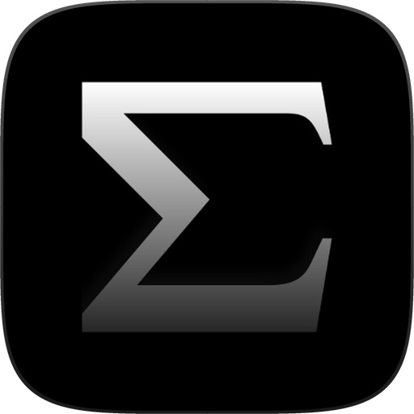
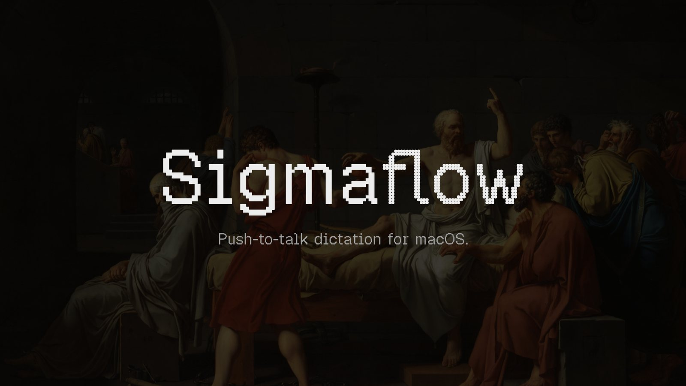

<p align="center">
  
</p>

<h1 align="center">SigmaFlow</h1>

<p align="center">You talk faster than you type.</p>

<p align="center">
  <a href="LICENSE"></a>
  
  <a href="https://github.com/itsgrj/SigmaFlow/releases/latest"></a>
  <a href="https://github.com/itsgrj/SigmaFlow/releases"></a>
  <a href="https://github.com/itsgrj/SigmaFlow/stargazers"></a>
</p>

<p align="center">
  <a href="https://github.com/itsgrj/SigmaFlow/releases/latest/download/SigmaFlow.dmg"></a>
</p>

<p align="center">
  
</p>

SigmaFlow is dictation for the Mac. Speak naturally, in Mail, Slack, Notes, anywhere you
type, and SigmaFlow writes it for you. Your voice never leaves your Mac.

## Get started

1. Download `SigmaFlow.dmg` from the [latest release](https://github.com/itsgrj/SigmaFlow/releases/latest)
   and drag SigmaFlow into Applications.
2. Open it. The first time, macOS asks you to confirm: System Settings ▸ Privacy & Security ▸
   Open Anyway.
3. SigmaFlow walks you through two quick permissions.
4. Hold Right ⌘ and talk. Let go, and SigmaFlow writes it where your cursor is.

## What it does

- **Writes in every app.** Hold Right ⌘ and talk. Tap it twice for hands free.
- **Writes your replies.** Hold Right ⌥ and say what you want, like “Reply to John,
  Thursday works but not before 11.” SigmaFlow reads your screen and writes the reply where
  you clicked. You check it and send it yourself.
- **Learns your words.** Fix a name once and SigmaFlow spells it right from then on.
- **Snippets.** Say “my work email” and get the address.
- **Styles.** Select text, press ⌥1, and SigmaFlow rewrites it in your voice.
- **Records meetings.** Calls and rooms, written down with each speaker, in English and
  Tamil, the moment the meeting ends.
- **Takes notes in the room.** A small card writes a conversation down as it happens, with
  photos and screenshots beside the words.
- **Finds anything.** Search every meeting by meaning, and every photo by what is in it.
- **Shows your day.** How much of today SigmaFlow wrote for you, and the time it gave back.
- **Works with Claude.** Add SigmaFlow to Claude Desktop once, then ask about any meeting,
  conversation or dictation.

Dictation, meetings and notes run on your Mac. Replies and styles are written by Apple
Intelligence on your Mac, or by Claude with your own key.

## Requirements

| You need | |
|---|---|
| macOS | 26 Tahoe or later |
| Mac | Apple silicon (M1 or later) |
| Space | Room for the speech model, downloaded on first open |
| Permissions | Microphone and Accessibility; Screen Recording for replies and notes |
| Optional | Apple Intelligence, or an Anthropic key, for replies and styles |

## Build from source

```bash
git clone https://github.com/itsgrj/SigmaFlow.git
cd SigmaFlow
make install
```

Needs the Xcode 26 Command Line Tools. Always build through `make`: it keeps the build out of
synced folders and signs the app so permissions survive a rebuild. More in
[CONTRIBUTING.md](CONTRIBUTING.md).

## Contributing

Bug reports, ideas and pull requests are welcome. Read [CONTRIBUTING.md](CONTRIBUTING.md)
first, and the [code of conduct](CODE_OF_CONDUCT.md).

## License

SigmaFlow is released under the [GNU General Public License v3.0](LICENSE).

## Acknowledgements

SigmaFlow stands on these:

- [FluidAudio](https://github.com/FluidInference/FluidAudio) runs Parakeet and the speaker
  separation on the Neural Engine.
- [NVIDIA Parakeet](https://huggingface.co/nvidia/parakeet-tdt-0.6b-v3) hears English.
- [AI4Bharat IndicConformer](https://huggingface.co/ai4bharat/indic-conformer-600m-multilingual)
  hears Tamil.
- [SpeechBrain VoxLingua107](https://huggingface.co/speechbrain/lang-id-voxlingua107-ecapa)
  tells the two apart.
- [MLX Swift](https://github.com/ml-explore/mlx-swift) and [Google Gemma](https://ai.google.dev/gemma)
  describe photos, and EmbeddingGemma makes search work by meaning.
- [FluidUse](https://github.com/FluidInference/FluidUse), where the EmbeddingGemma tokenizer
  comes from.
- [swift-transformers](https://github.com/huggingface/swift-transformers) by Hugging Face.
- [IBM Plex](https://github.com/IBM/plex) and [IBM Carbon icons](https://github.com/carbon-design-system/carbon/tree/main/packages/icons)
  for type and icons.
- [Open Library](https://openlibrary.org) for the book covers in Insights.
- *The Death of Socrates* by Jacques-Louis David, 1787, behind every page.
