<p align="center">
  
</p>

<h1 align="center">SigmaFlow</h1>

<p align="center"><b>Write at the speed of your thought</b></p>

<p align="center">
  Dictation, meeting notes and replies, with AI that runs on your Mac.<br>
  Free and open source.
</p>

<p align="center">
  <a href="LICENSE"></a>
  
  <a href="https://github.com/itsgrj/SigmaFlow/releases/latest"></a>
  <a href="https://github.com/itsgrj/SigmaFlow/releases"></a>
  <a href="https://github.com/itsgrj/SigmaFlow/stargazers"></a>
</p>

<p align="center">
  <a href="https://github.com/itsgrj/SigmaFlow/releases/latest/download/SigmaFlow.dmg"></a>
</p>

<p align="center">
  
</p>

<p align="center">
  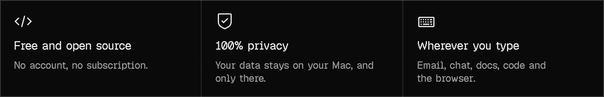
</p>

Most people pay for three apps to do this: one to dictate, one to take meeting notes, one to
turn recordings into text. SigmaFlow is all three, it’s free, and it runs on your Mac.

## Write anywhere

Hold a key, talk, let go. SigmaFlow writes it where your cursor is.

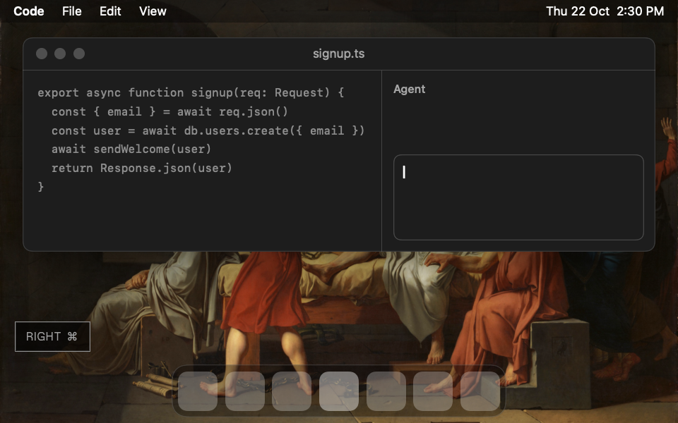

### Talk the way you think

Hold Right ⌘ and talk, in Cursor, Claude Code, Mail, Slack or anywhere else you type. Say
um, pause, take your time. Let go, and SigmaFlow writes it where your cursor is, without
the ums. All on your Mac.

<br clear="left">
<br>

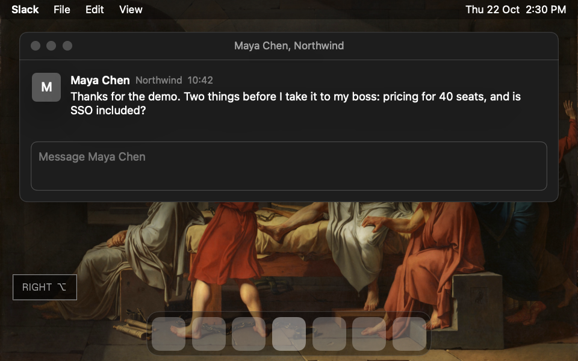

### Replies, written for you

Click in the reply box, hold Right ⌥ and say what you want: “tell Maya 40 seats is the
Team plan, SSO included, quote by tomorrow.” SigmaFlow reads the message on your screen
and writes the reply. You read it and press send.

<br clear="left">
<br>

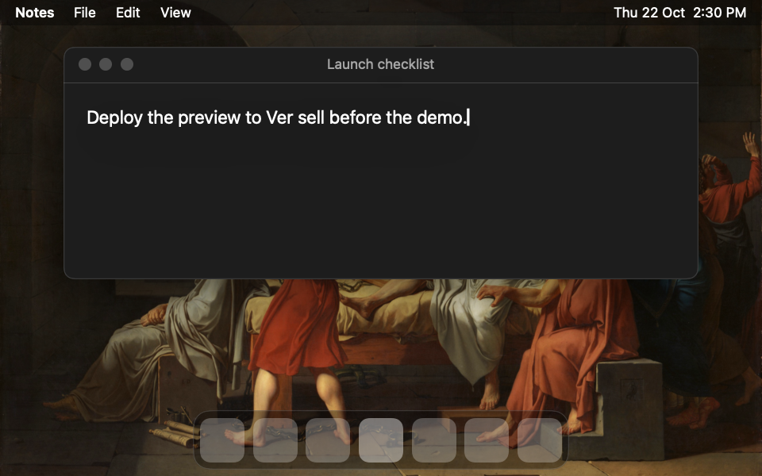

### Names come out right

Fix a name once and SigmaFlow learns it. Vercel stays Vercel, Northwind stays Northwind,
every time after. Don’t want it learned? One click says no.

<br clear="left">
<br>

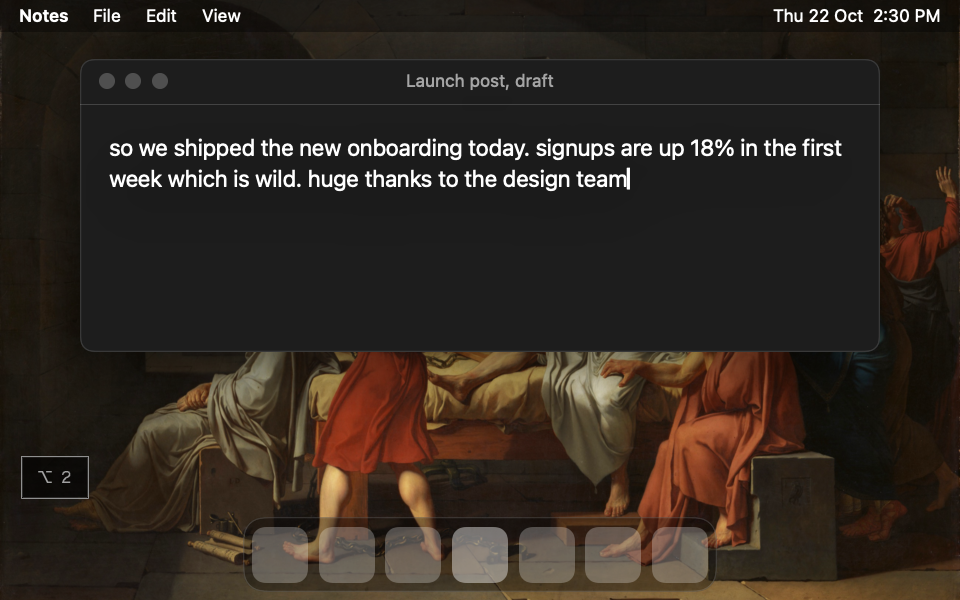

### Rewrite anything with one key

Select text and press ⌥2. SigmaFlow rewrites it in place, as a launch post, a formal
email, or the way you write, learned from examples of your own.

<br clear="left">
<br>

| What you say | What SigmaFlow writes |
|---|---|
| *um, add rate limiting to the signup endpoint, uh, ten requests a minute per IP* | Add rate limiting to the signup endpoint, ten requests a minute per IP. |
| *deploy the preview to ver sell* (after you fixed it once) | Deploy the preview to Vercel. |
| *my calendar link* | cal.example.com/you |

**And the small things**

<picture><source media="(prefers-color-scheme: dark)" srcset="docs/readme/icons/locked-dark.svg"></picture>&nbsp; **Hands free.** Tap Right ⌘ twice and keep talking, with nothing held down.<br>
<picture><source media="(prefers-color-scheme: dark)" srcset="docs/readme/icons/paste-dark.svg"></picture>&nbsp; **Snippets.** Say “my calendar link” and SigmaFlow types it.<br>
<picture><source media="(prefers-color-scheme: dark)" srcset="docs/readme/icons/send-dark.svg"></picture>&nbsp; **Sends it for you.** Turn on Power mode, hold Right ⌥ as you let go, and SigmaFlow presses Return too.<br>
<picture><source media="(prefers-color-scheme: dark)" srcset="docs/readme/icons/volume--mute-dark.svg"></picture>&nbsp; **Quiet while you talk.** Music and videos pause while you dictate, and play again after.

## Every conversation, written down

Sales calls, standups and planning sessions, in English and Tamil, written down on your Mac
the moment they end.

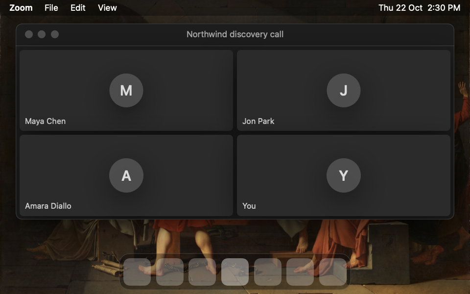

### No bots in your meetings

When a call starts in Zoom, Teams, Google Meet or FaceTime, SigmaFlow asks to record it. It
hears both sides, even through AirPods. When the call ends, SigmaFlow has written down who
said what and given the meeting a title, all on your Mac. A two-hour call takes about two
minutes.

<br clear="left">
<br>

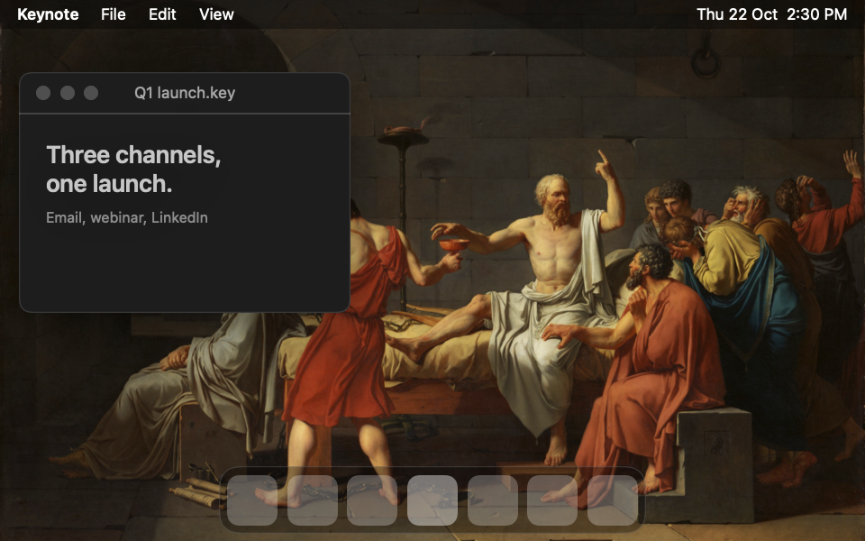

### Notes for the meetings in a room

Press ⌃⌥N and a small card writes the conversation down as it happens. Photos of the
whiteboard and screenshots of your screen land beside the words said at that moment.

<br clear="left">
<br>

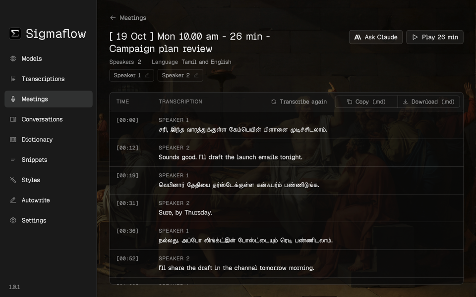

### Tamil and English, as you speak them

Meetings in Tamil, in English, or both at once. SigmaFlow hears which is which, and writes
Tamil in Tamil and English in English.

<br clear="left">
<br>

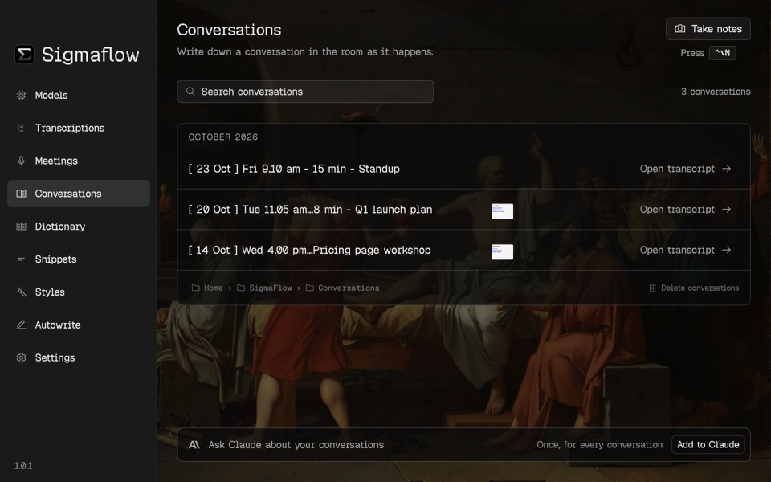

### Find it by what was said, or shown

Search every meeting and conversation by meaning, not just exact words. Photos and
screenshots are searched by what is in them: type “whiteboard” and every whiteboard comes
up.

<br clear="left">
<br>

**And the small things**

<picture><source media="(prefers-color-scheme: dark)" srcset="docs/readme/icons/upload-dark.svg"></picture>&nbsp; **Drop a recording.** Drag any audio or video file onto Meetings, and SigmaFlow writes it down the same way.<br>
<picture><source media="(prefers-color-scheme: dark)" srcset="docs/readme/icons/play-dark.svg"></picture>&nbsp; **Play from any line.** Click a line in a transcript and hear that moment.<br>
<picture><source media="(prefers-color-scheme: dark)" srcset="docs/readme/icons/user--speaker-dark.svg"></picture>&nbsp; **Name a speaker once.** Click Speaker 2, type a name, and every line of theirs follows.

## Yours, and ready for any AI

What SigmaFlow writes down isn’t locked in an app. It’s a tidy folder on your Mac that any AI
can read.

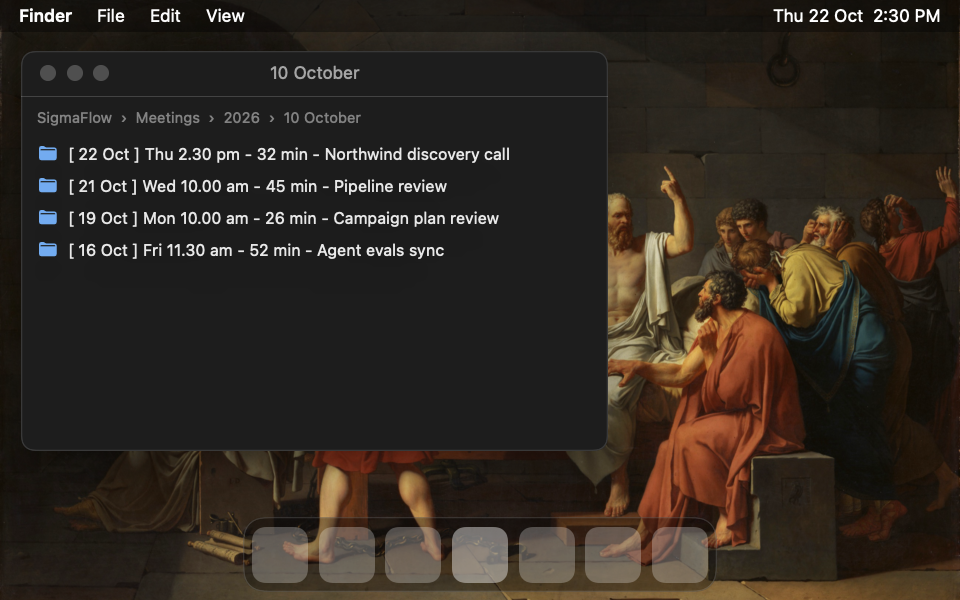

### Saved on your Mac, ready for any AI

Every meeting, conversation and dictation is saved on your Mac as a Markdown file, beside its
audio and photos. Folders go by year and month. Every name starts with the date, the time
and the length, then the title. Inside, each file says when it was, how long, who was there
and in what language, then every line with its time and its speaker.

<br clear="left">
<br>

Hand the folder to Claude, ChatGPT, Cursor or Obsidian and they understand it right away: who
said what, when, and what was on the whiteboard. Move to another app one day, and every
meeting still makes sense.

```
~/SigmaFlow
├── Meetings/2026/10 October/
│   └── [ 22 Oct ] Thu 2.30 pm - 32 min - Northwind discovery call/
│       ├── [ 22 Oct ] Thu 2.30 pm - 32 min - Northwind discovery call.md
│       └── [ 22 Oct ] Thu 2.30 pm - 32 min - Northwind discovery call.m4a
├── Conversations/2026/10 October/
│   └── [ 20 Oct ] Tue 11.05 am - 48 min - Q1 launch plan/
│       ├── [ 20 Oct ] Tue 11.05 am - 48 min - Q1 launch plan.md
│       ├── [ 20 Oct ] Tue 11.05 am - 48 min - Q1 launch plan.m4a
│       └── Photos/[ 20 Oct ] Tue 11.05 am - 03-09.jpg
└── Dictations/2026/10 October.md
```

```markdown
# [ 22 Oct ] Thu 2.30 pm - 32 min - Northwind discovery call

Date: Thursday 22 October 2026, 2.30 pm
Length: 32 min
From: Zoom
Speakers: 3
Language: English
Audio: [ 22 Oct ] Thu 2.30 pm - 32 min - Northwind discovery call.m4a

| Time | Transcription |
|---|---|
| [00:00] | **Speaker 1:** Thanks for making time. What’s slowing your team down today? |
| [00:38] | **Speaker 2:** Our reps spend about an hour a day writing up calls in the CRM. |
| [01:12] | **Speaker 3:** And security won’t sign off on anything without SSO. |
```

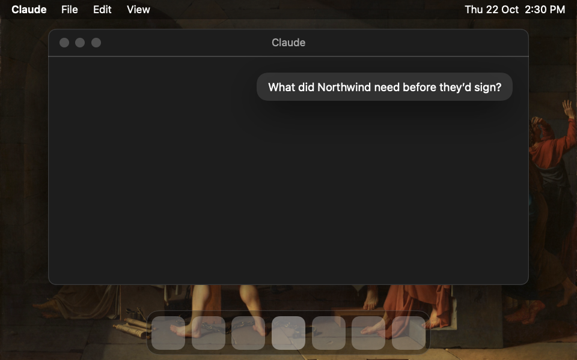

### Ask Claude about any meeting

Add SigmaFlow to Claude Desktop with one click. Then ask “what did Northwind need before
they’d sign?” and Claude reads your meetings, notes and dictations to answer.

<br clear="left">
<br>

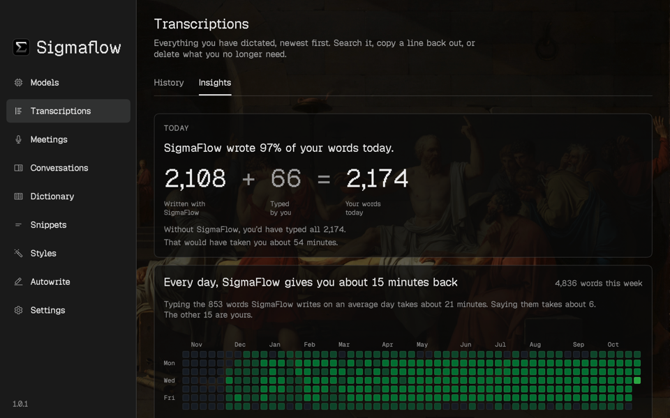

### See the time you got back

SigmaFlow counts the words it wrote for you today, and how long they would have taken to
type. No streaks, no goals. Just the number.

<br clear="left">
<br>

## AI that runs on your Mac

Every model SigmaFlow needs runs on your Mac. Nothing you say is uploaded unless you choose
Claude, and dictation, meetings and search work without the internet.

| | Job | Runs on your Mac |
|---|---|---|
| <picture><source media="(prefers-color-scheme: dark)" srcset="docs/readme/icons/microphone-dark.svg"></picture> | Hears you, as you speak | NVIDIA Parakeet |
| <picture><source media="(prefers-color-scheme: dark)" srcset="docs/readme/icons/user--multiple-dark.svg"></picture> | Tells the speakers apart | FluidAudio speaker separation |
| <picture><source media="(prefers-color-scheme: dark)" srcset="docs/readme/icons/translate-dark.svg"></picture> | Hears Tamil, and knows when it is Tamil | AI4Bharat IndicConformer, SpeechBrain VoxLingua107 |
| <picture><source media="(prefers-color-scheme: dark)" srcset="docs/readme/icons/magic-wand-dark.svg"></picture> | Names meetings, writes replies and styles | Apple Intelligence, or Claude with your own key |
| <picture><source media="(prefers-color-scheme: dark)" srcset="docs/readme/icons/image-dark.svg"></picture> | Reads photos and screenshots | Google Gemma 4, Apple Vision |
| <picture><source media="(prefers-color-scheme: dark)" srcset="docs/readme/icons/search-dark.svg"></picture> | Searches by meaning | Google EmbeddingGemma |

No account. No subscription. No bots in your calls.

## Get started

1. Download `SigmaFlow.dmg` from the [latest release](https://github.com/itsgrj/SigmaFlow/releases/latest)
   and drag SigmaFlow into Applications.
2. Open it. The first time, macOS asks you to confirm: System Settings ▸ Privacy & Security ▸
   Open Anyway.
3. SigmaFlow walks you through two quick permissions.
4. Hold Right ⌘ and talk. Let go, and SigmaFlow writes it where your cursor is.

## Requirements

| You need | |
|---|---|
| macOS | 26 Tahoe or later |
| Mac | Apple silicon (M1 or later) |
| Space | Room for the speech model, downloaded on first open |
| Permissions | Microphone and Accessibility; Screen Recording for replies and notes |
| Optional | Apple Intelligence, or an Anthropic key, for replies and styles |

## Build from source

```bash
git clone https://github.com/itsgrj/SigmaFlow.git
cd SigmaFlow
make install
```

Needs the Xcode 26 Command Line Tools. Always build through `make`: it keeps the build out of
synced folders and signs the app so permissions survive a rebuild. More in
[CONTRIBUTING.md](CONTRIBUTING.md).

## Contributing

Bug reports, ideas and pull requests are welcome. Read [CONTRIBUTING.md](CONTRIBUTING.md)
first, and the [code of conduct](CODE_OF_CONDUCT.md).

## License

SigmaFlow is released under the [GNU General Public License v3.0](LICENSE).

## Acknowledgements

SigmaFlow stands on these:

- [FluidAudio](https://github.com/FluidInference/FluidAudio) runs Parakeet and the speaker
  separation on the Neural Engine.
- [NVIDIA Parakeet](https://huggingface.co/nvidia/parakeet-tdt-0.6b-v3) hears English.
- [AI4Bharat IndicConformer](https://huggingface.co/ai4bharat/indic-conformer-600m-multilingual)
  hears Tamil.
- [SpeechBrain VoxLingua107](https://huggingface.co/speechbrain/lang-id-voxlingua107-ecapa)
  tells the two apart.
- [MLX Swift](https://github.com/ml-explore/mlx-swift) and [Google Gemma](https://ai.google.dev/gemma)
  describe photos, and EmbeddingGemma makes search work by meaning.
- [FluidUse](https://github.com/FluidInference/FluidUse), where the EmbeddingGemma tokenizer
  comes from.
- [swift-transformers](https://github.com/huggingface/swift-transformers) by Hugging Face.
- [IBM Plex](https://github.com/IBM/plex) and [IBM Carbon icons](https://github.com/carbon-design-system/carbon/tree/main/packages/icons)
  for type and icons.
- [Open Library](https://openlibrary.org) for the book covers in Insights.
- *The Death of Socrates* by Jacques-Louis David, 1787, behind every page.

<br>

<p align="center"><b>You talk faster than you type. Now SigmaFlow keeps up.</b></p>

<p align="center">
  <a href="https://github.com/itsgrj/SigmaFlow/releases/latest/download/SigmaFlow.dmg"></a>
</p>
